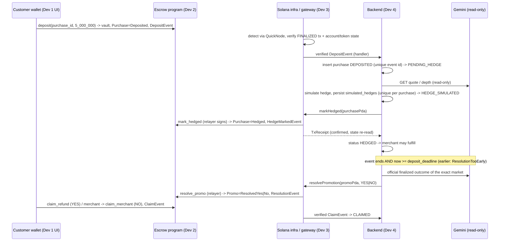
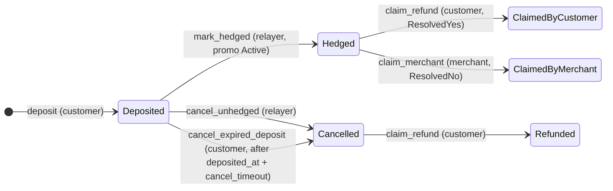
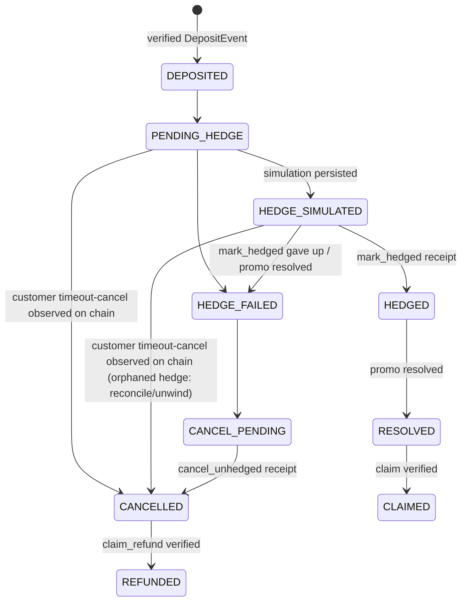

# Workflow and state machines

Two separate state spaces: **on-chain** (authoritative for funds) and **Supabase** processing
states (derived). Field/instruction details: [interfaces.md](interfaces.md).

## Checkout, hedge, settlement (happy path)



A backend callback cannot mutate Solana state: the backend asks the gateway, which builds and signs
the `mark_hedged` transaction with the server-side relayer key. The purchase is **not HEDGED** until
the gateway returns a confirmed receipt.

## Hedge failure → cancel → refund

```mermaid
sequenceDiagram
  participant B as Backend (Dev 4)
  participant G as Gateway (Dev 3)
  participant P as Escrow program
  participant C as Customer wallet
  B->>B: quote over cap / stale / illiquid / partial / unavailable -> HEDGE_FAILED
  B->>G: cancelUnhedged(purchasePda) (status CANCEL_PENDING)
  G->>P: cancel_unhedged (relayer) -> Cancelled, PurchaseCancelledEvent
  G-->>B: TxReceipt -> CANCELLED (refundable; void any simulated hedge)
  C->>P: claim_refund -> Refunded (tokens to customer ATA), ClaimEvent
  G->>B: verified ClaimEvent / verifyTransaction -> REFUNDED
```

Cancellation creates an entitlement; the customer pulls the refund. `REFUNDED` is set only after
the refund transaction is verified.

## On-chain state machines



Promo: `Active → ResolvedYes | ResolvedNo` via `resolve_promo` (once, relayer, only at/after
`deposit_deadline`). Terminal purchase states: `Refunded`, `ClaimedByCustomer`, `ClaimedByMerchant`.
`Hedged` cannot be cancelled (by the relayer **or** by any timeout);
`Cancelled` cannot be hedged; every payout leaves its purchase in a terminal state in the same
instruction (no double claim).

## Backend (Supabase) status machine — Dev 4



| Backend status    | On-chain state at that time      | Set when                                       |
| ----------------- | -------------------------------- | ---------------------------------------------- |
| `DEPOSITED`       | Deposited                        | verified deposit recorded                      |
| `PENDING_HEDGE`   | Deposited                        | worker leased the purchase                     |
| `HEDGE_SIMULATED` | Deposited                        | simulated hedge persisted, mark_hedged pending |
| `HEDGED`          | Hedged                           | mark_hedged receipt                            |
| `HEDGE_FAILED`    | Deposited                        | simulation failed / mark_hedged abandoned      |
| `CANCEL_PENDING`  | Deposited (or already Cancelled) | cancel_unhedged requested                      |
| `CANCELLED`       | Cancelled                        | cancel_unhedged receipt                        |
| `REFUNDED`        | Refunded                         | refund tx verified                             |
| `RESOLVED`        | Hedged                           | promo resolved on-chain                        |
| `CLAIMED`         | ClaimedByCustomer / ByMerchant   | claim tx verified                              |

## Idempotency and races

- **Hedge simulation is persisted once**: `simulated_hedges` has a unique key on `purchase_id`.
  Retrying `markHedged` reuses the stored hedge and never re-quotes or double-counts premium/budget.
  Budget/exposure is reserved in the same transaction that inserts the hedge.
- **`mark_hedged` vs `cancel_unhedged` vs `cancel_expired_deposit`**: all need `Deposited` and write
  the same Purchase account, so the runtime serializes them: exactly one succeeds; the others fail
  `INVALID_STATE` (or `AlreadyCancelled`/`AlreadyHedged` for same-target retries). Backend reacts by
  re-reading state (`getPurchaseState`) and aligning the DB, never by assuming. If a cancel wins, the
  simulated hedge becomes `VOIDED` **only after any executed hedge exposure is accounted for**
  (CLAUDE.md §5.1): a customer's timeout cancel can land after the hedge executed but before
  `mark_hedged` confirmed, leaving orphaned exposure that the contract cannot see.
- **Customer timeout cancel**: allowed once `deposited_at + promo.cancel_timeout_secs` has passed
  (Devnet default 600 s), only for a still-`Deposited` purchase, in any promo state and while paused.
  The backend must stop starting hedges well before that deadline (CLAUDE.md §5.1).
- **`mark_hedged` vs `resolve_promo`**: `mark_hedged` requires promo `Active` (read-only); if
  resolution lands first, `mark_hedged` fails and the backend cancels instead. `mark_hedged` does
  not write the Promo account, so it never contends with deposits.
- **Resolution** is once-only on-chain and only at/after `deposit_deadline` (before it:
  `ResolutionTooEarly`, retry later); repeated calls with the same outcome → `alreadyApplied`,
  a conflicting one → `INVALID_STATE` (alert an operator).
- **Unknown outcome of a send** (`TX_TIMEOUT`): re-read on-chain state before retrying.
