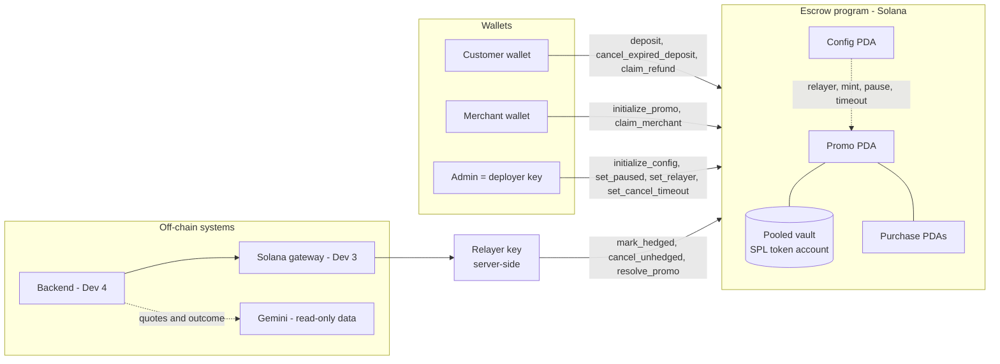
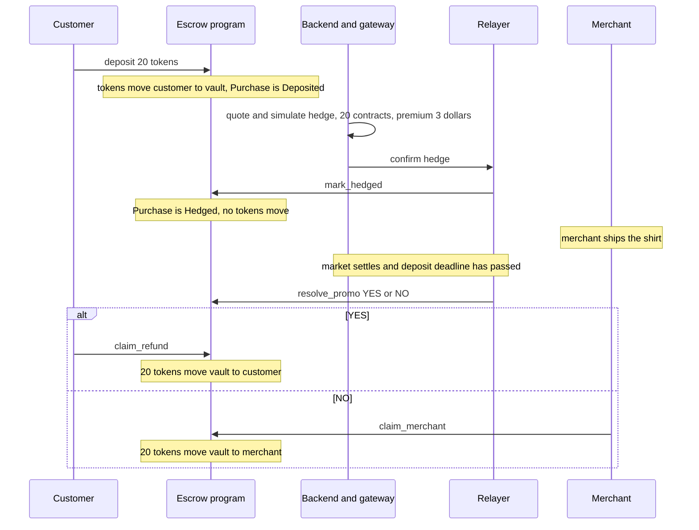
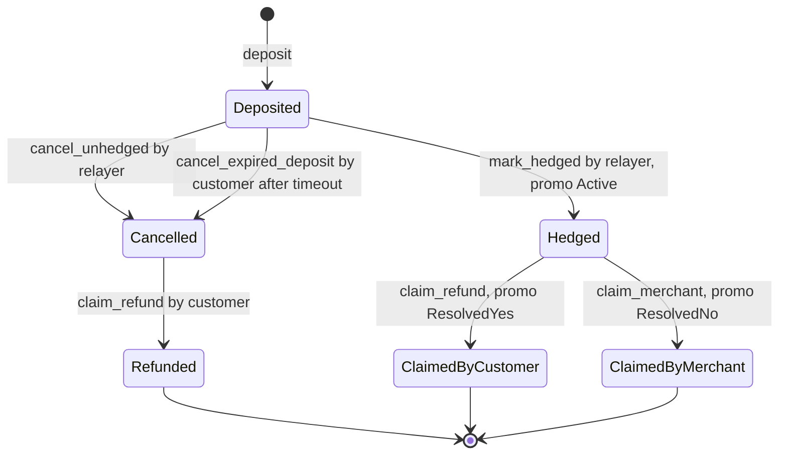
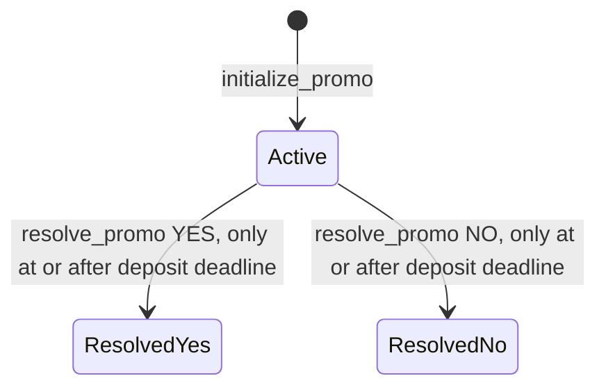

# Hedged Refund Escrow — technical overview

High-level documentation of the Anchor escrow program in `programs/escrow` (Developer 2). It explains
what the program does, what it guarantees, and what it deliberately leaves to off-chain systems.

**How to read the labels.** Throughout this document:

- **[IMPLEMENTED]** — enforced by the Rust program and covered by tests.
- **[ASSUMPTION]** — an operational or economic assumption outside the program (backend, exchange,
  operator behavior). The program does not enforce it.
- **[PENDING]** — a required piece of work owned by another developer that is not implemented yet.
- **[POST-MVP]** — a planned feature that is intentionally not built.

Everything runs on **Solana Devnet** with a valueless 6-decimal mock USD token. The program is **not yet
deployed**; it is tested on a local validator. Hedges are **simulated** off-chain; nothing here trades real
money. Related documents: `docs/interfaces.md` (contract), `docs/workflow.md` (flows), and in
`programs/escrow/docs/`: `SECURITY.md`, `INTEGRATION.md`, `DEVNET.md`, `D2-PROPOSAL.md`.

---

## 1. Project overview

### The use case: a $20 T-shirt with a conditional refund

A merchant sells a **$20 T-shirt** with this promotion: _"Buy it now. If Texas wins, we refund your $20."_
The merchant can afford the promise because it **hedges**: it buys prediction-market contracts that pay
out if Texas wins, so a win does not cost the merchant its sales revenue.

1. The customer pays **$20** (20 mock USD, `20_000_000` base units) into an on-chain **escrow vault**.
2. The merchant's backend buys **20 YES contracts** that each pay **$1** if Texas wins. At an assumed
   price of **$0.15** per contract the **premium is 20 × $0.15 = $3**. In this MVP that purchase is
   **simulated** off-chain; the program never sees it.
3. Once the hedge is confirmed, the backend tells the program (`mark_hedged`), the purchase becomes
   `Hedged`, and the merchant ships the shirt.
4. When the market is officially settled, the trusted relayer records the outcome on-chain
   (`resolve_promo`).
5. **Texas wins (YES):** the customer gets the $20 back from escrow. **Texas loses (NO):** the merchant
   takes the $20 from escrow.

The program is **amount-agnostic**: every promotion fixes an `offer_amount` and every deposit must equal
it. The $20 / $3 / $0.15 figures are an illustration, not constants in the code (`docs/interfaces.md`
uses a 5-token demo amount).

### What the program is, and is not

| The program **is** (on-chain)                                             | The program is **not**                                           |
| ------------------------------------------------------------------------- | ---------------------------------------------------------------- |
| An escrow that holds each customer's deposit and pays it out exactly once | A trading system: it never sees prices, contracts or the premium |
| A state machine per purchase and per promotion                            | An oracle: the outcome comes from the trusted relayer            |
| Authorization (who may cancel, resolve, claim) and a global pause         | A guarantee that a hedge exists or was unwound (off-chain)       |
| Exact accounting: every payout equals one purchase's own deposit          | A custodian of anything except the mock token in its vaults      |

---

## 2. Architecture

### Components and responsibilities



### Accounts (all PDAs of the escrow program)

| Account    | Seeds                                                | Holds                                                                                                                                                                      |
| ---------- | ---------------------------------------------------- | -------------------------------------------------------------------------------------------------------------------------------------------------------------------------- |
| `Config`   | `["config"]`                                         | `admin`, the single `relayer`, the only accepted `mint`, `paused`, `bump`, `cancel_timeout_secs`. One per program.                                                         |
| `Promo`    | `["promo", merchant, promo_nonce u64 LE]`            | `merchant`, `mint`, `vault`, `offer_amount`, `deposit_deadline`, `market_id` (≤ 64 bytes), `state`, `resolved_at`, accounting totals, a snapshot of `cancel_timeout_secs`. |
| Vault      | associated token account of the `Promo` PDA + mint   | The **one pooled** token account for the promotion. The `Promo` PDA is its authority, so only this program can move tokens out of it.                                      |
| `Purchase` | `["purchase", promo, customer, purchase_id [u8;16]]` | One per deposit: `customer`, `purchase_id`, `amount`, `state`, timestamps (`deposited_at`, `hedged_at`, `cancelled_at`, `settled_at`).                                     |

One customer can hold many purchases because `purchase_id` is unique per deposit, and including the
customer in the seeds stops another wallet squatting someone's id. **[IMPLEMENTED]**

### Roles and authorization

| Role         | Who                                      | May do                                                                                                                       |
| ------------ | ---------------------------------------- | ---------------------------------------------------------------------------------------------------------------------------- |
| **Admin**    | the deployer (program upgrade authority) | `initialize_config` (once), `set_paused`, `set_relayer`, `set_cancel_timeout`. **No instruction lets the admin move funds.** |
| **Relayer**  | one key stored in `Config.relayer`       | `mark_hedged`, `cancel_unhedged`, `resolve_promo`. Cannot redirect funds: it only changes states.                            |
| **Merchant** | `Promo.merchant`                         | `initialize_promo`, `claim_merchant` (hedged purchases after NO).                                                            |
| **Customer** | `Purchase.customer`                      | `deposit`, `cancel_expired_deposit` (own purchase, after the timeout), `claim_refund` (own purchase).                        |

### On-chain vs off-chain responsibilities

| Concern                                                         | Where it lives             | Status                          |
| --------------------------------------------------------------- | -------------------------- | ------------------------------- |
| Escrowing deposits, exact per-purchase payouts, accounting      | Program                    | **[IMPLEMENTED]**               |
| Who may cancel / resolve / claim; pause; deadlines; timeout     | Program                    | **[IMPLEMENTED]**               |
| Choosing the market, price cap, budget                          | Backend (off-chain policy) | **[PENDING]** (Dev 4)           |
| Quoting, buying (simulating) the hedge, retries, reconciliation | Backend                    | **[PENDING]** (Dev 4)           |
| Reading the official market result, deciding YES/NO             | Backend + trusted relayer  | **[ASSUMPTION]** honest relayer |
| Building/sending relayer transactions, verifying events         | Solana gateway             | **[PENDING]** (Dev 3)           |
| "Do not ship before `HEDGED`"                                   | Merchant UI/backend        | **[ASSUMPTION]**                |

---

## 3. Lifecycle

### Happy path (T-shirt, hedge succeeds)



### Token movements, step by step (one $20 purchase)

Only **deposits and claims** move tokens. Every other instruction changes state only. **[IMPLEMENTED]**

| Step | Instruction               | Token movement                           | Resulting state                     |
| ---- | ------------------------- | ---------------------------------------- | ----------------------------------- |
| 1    | `deposit`                 | customer account **−20** → vault **+20** | Purchase `Deposited`                |
| 2    | `mark_hedged` (relayer)   | none                                     | Purchase `Hedged`                   |
| 3    | `resolve_promo` (relayer) | none (and no purchase is touched)        | Promo `ResolvedYes` or `ResolvedNo` |
| 4a   | `claim_refund` after YES  | vault **−20** → customer account **+20** | Purchase `ClaimedByCustomer`        |
| 4b   | `claim_merchant` after NO | vault **−20** → merchant account **+20** | Purchase `ClaimedByMerchant`        |

### If the hedge fails (or nobody hedges)

| Path                          | Instruction                                            | Tokens move?                                          |
| ----------------------------- | ------------------------------------------------------ | ----------------------------------------------------- |
| Backend gives up on the hedge | `cancel_unhedged` (relayer, any time)                  | no — creates a refund entitlement                     |
| Relayer is silent             | `cancel_expired_deposit` (customer, after the timeout) | no — creates a refund entitlement                     |
| Customer collects the refund  | `claim_refund` (cancel path)                           | vault **−20** → customer **+20**; Purchase `Refunded` |

Both cancellations lead to the same `Cancelled` state; the customer then pulls the refund. The refund is
the full deposit, never partial. **[IMPLEMENTED]**

### Time rules

- **Deposits** are accepted only while `now < deposit_deadline`.
- **Resolution** is allowed only when `now >= deposit_deadline`. The two rules are exact complements, so
  deposits and resolution never overlap and never leave a gap (D4). **[IMPLEMENTED]**
- **Customer timeout cancel** is allowed once `now >= deposited_at + promo.cancel_timeout_secs`
  (inclusive). The timeout is set by the admin (1 second to 30 days), copied into each promo when it is
  created, and is **600 s (10 minutes)** by default on Devnet (set by `pnpm escrow:init-config`).
  **[IMPLEMENTED]**

---

## 4. State machines

### Purchase



Terminal states are one-way: a settled purchase can never move again, which is what prevents double
claims. A `Hedged` purchase can **never** be cancelled, by the relayer or by any timeout.

### Promotion



A promo is resolved **exactly once**; there is no way back and no way to change the outcome.

### Transition table

| Instruction              | From → To                    | Who                     | Extra conditions                                          | Paused?     |
| ------------------------ | ---------------------------- | ----------------------- | --------------------------------------------------------- | ----------- |
| `deposit`                | — → `Deposited`              | customer                | promo `Active`, `now < deadline`, amount = `offer_amount` | blocked     |
| `mark_hedged`            | `Deposited → Hedged`         | relayer                 | promo `Active`                                            | blocked     |
| `cancel_unhedged`        | `Deposited → Cancelled`      | relayer                 | any promo state                                           | **allowed** |
| `cancel_expired_deposit` | `Deposited → Cancelled`      | the purchase's customer | `now ≥ deposited_at + timeout`; any promo state           | **allowed** |
| `resolve_promo`          | `Active → ResolvedYes/No`    | relayer                 | `now ≥ deposit_deadline`                                  | blocked     |
| `claim_refund`           | `Cancelled → Refunded`       | the purchase's customer | any promo state                                           | **allowed** |
| `claim_refund`           | `Hedged → ClaimedByCustomer` | the purchase's customer | promo `ResolvedYes`                                       | blocked     |
| `claim_merchant`         | `Hedged → ClaimedByMerchant` | merchant                | promo `ResolvedNo`; one purchase per call                 | blocked     |

Why pause works this way: pause stops everything that opens new liabilities or pays merchants/resolves
(the actions a compromised relayer or a bug could abuse), but it keeps the two paths that can only return a
customer's own money to that same customer. **[IMPLEMENTED]**

---

## 5. Economics

### The numbers (illustration)

| Item                                          | Value                             |
| --------------------------------------------- | --------------------------------- |
| Price of the T-shirt (escrowed)               | **$20**                           |
| Hedge: YES contracts, each paying $1 on a win | **20 contracts** → **$20** payout |
| Assumed YES price per contract                | **$0.15**                         |
| Hedge premium (paid by the merchant)          | 20 × $0.15 = **$3**               |

### What each side gets

| Outcome                          | Escrow ($20) goes to   | Hedge payout (off-chain) | Merchant cash after the $3 premium | Customer                     |
| -------------------------------- | ---------------------- | ------------------------ | ---------------------------------- | ---------------------------- |
| **YES** (Texas wins)             | customer (refund)      | +$20 to the merchant     | $20 − $3 = **$17**                 | pays $0 net, keeps the shirt |
| **NO** (Texas loses)             | merchant               | $0 (contracts expire)    | $20 − $3 = **$17**                 | pays $20, keeps the shirt    |
| Hedge failed, purchase cancelled | customer (full refund) | none (no hedge held)     | $0 and no shirt shipped            | pays $0, no shirt            |

So the merchant's **retained sales cash is about $17 under either outcome** — the premium is the price of
the promise. This is a **gross** figure: it is **before** the cost of the T-shirt, trading fees, spread,
slippage, partial fills, taxes and any mismatch between the escrow and the market. It is **not profit**,
and nothing here promises a profit. In this MVP the hedge is **simulated**, so no real hedge payout or
premium exists.

### Assumptions versus on-chain guarantees

| On-chain guarantee **[IMPLEMENTED]**                                     | Off-chain assumption **[ASSUMPTION]** (not enforced by the program)                          |
| ------------------------------------------------------------------------ | -------------------------------------------------------------------------------------------- |
| The customer's $20 sits in the vault until it is paid out exactly once.  | A hedge of the right size was actually bought (the program only trusts the relayer's flag).  |
| After YES only the customer can take it; after NO only the merchant can. | The hedge pays $20 on a win and the merchant keeps that payout (separate ledger; no bridge). |
| Cancelled purchases refund the full $20 to the same customer.            | The premium ($3) is funded by the merchant, and the quote ($0.15) is real and fresh.         |
| The outcome is recorded once and cannot be changed.                      | The relayer records the true, officially settled outcome.                                    |
| Payout can never exceed that purchase's own deposit.                     | Fees, slippage and fills are modeled correctly by the backend.                               |

The program holds only the customer's tokens. **The hedge premium, the contracts and their payoff never
touch the program**, and the program has no field that records them.

---

## 6. Edge cases

Each row separates what the code does today from what is left to operations or future work. Evidence for
every row (Rust location and test) is in the appendix at the end.

| #   | Scenario                                                                                                               | Risk                                                                             | Current protection **[IMPLEMENTED]**                                                                                                                                                                                     | Remaining limitation                                                                                                                                                                                                                |
| --- | ---------------------------------------------------------------------------------------------------------------------- | -------------------------------------------------------------------------------- | ------------------------------------------------------------------------------------------------------------------------------------------------------------------------------------------------------------------------ | ----------------------------------------------------------------------------------------------------------------------------------------------------------------------------------------------------------------------------------- |
| 1   | A non-relayer (customer, merchant, admin, random key) calls `mark_hedged`, `cancel_unhedged` or `resolve_promo`        | Forged hedge status or outcome                                                   | Signer must equal `Config.relayer`; the admin has no implicit relayer rights; unsigned calls fail                                                                                                                        | The relayer itself is trusted (row 13)                                                                                                                                                                                              |
| 2   | Someone calls `initialize_config` first after deployment                                                               | Attacker becomes admin and picks relayer and mint                                | Only the program's upgrade authority can initialize; wrong `program_data` rejected; all-zero relayer rejected                                                                                                            | The deployer key is the admin; if the upgrade authority is revoked before initialization, Config can never be created                                                                                                               |
| 3   | Attacker pre-creates a future promo's vault token account                                                              | The promo can never be created                                                   | Vault is created with `init_if_needed`; owner and mint are pinned by the associated-token constraints; no delegate or close authority exists; donated tokens are not claimable                                           | Donated tokens stay in the vault forever (no admin sweep by design)                                                                                                                                                                 |
| 4   | Wrong mint, wrong token account owner, wrong vault, or a fake token program is passed                                  | Funds routed to or taken from the wrong place                                    | Mint, destination owner, `promo.vault` and the token program are all checked; failures name the specific error                                                                                                           | The mock mint is assumed to have no freeze authority (row 21)                                                                                                                                                                       |
| 5   | A Promo passed as a Purchase (or vice versa), a purchase paired with another promo, or a fake config account           | Type confusion; one purchase consuming another's funds                           | Account discriminators, PDA seeds and `has_one = promo` are checked; a purchase's customer is bound by its seeds                                                                                                         | —                                                                                                                                                                                                                                   |
| 6   | Invalid transitions: hedge a cancelled purchase, cancel a hedged one, claim before resolution, claim the wrong outcome | Inconsistent states or wrong payouts                                             | One-way state machine; each instruction accepts only its legal source state; hedged purchases are never cancellable                                                                                                      | —                                                                                                                                                                                                                                   |
| 7   | Replay of a relayer call or a double claim                                                                             | Double hedge, double payout                                                      | Re-sending after success fails with a distinct `Already*` error and changes nothing; terminal states cannot move; two concurrent identical-intent transactions: exactly one succeeds                                     | The backend must re-read state to tell a harmless retry from a conflict                                                                                                                                                             |
| 8   | Races: `mark_hedged` vs `cancel_unhedged`, vs customer cancel, vs `resolve_promo`; YES vs NO resolution                | Contradictory state                                                              | All need the same account state, so the runtime serializes them: exactly one wins and state stays consistent; the loser fails cleanly                                                                                    | Which side wins is not controlled (see row 9)                                                                                                                                                                                       |
| 9   | **Off-chain hedge executes, but the customer's timeout cancel lands before `mark_hedged` confirms**                    | **Orphaned exposure**: a hedge exists for a purchase that will never be `Hedged` | On-chain, the purchase is simply `Cancelled` and fully refundable; `mark_hedged` then fails with `InvalidState`; accounting stays exact                                                                                  | The program cannot see or unwind the hedge. **[PENDING]** Dev 4 must stop hedging well before the timeout, confirm `mark_hedged`, and flag/unwind orphaned positions (CLAUDE.md §5.1). With a simulated hedge there is no real loss |
| 10  | The hedge API fails, times out, or partially fills                                                                     | Duplicate or half-covered hedge                                                  | The program only ever sees confirmed states; a purchase that cannot be hedged is cancelled (`cancel_unhedged`) and refunded in full                                                                                      | **[PENDING]** idempotent retries, order reconciliation and partial-fill handling are Dev 4 work, not implemented                                                                                                                    |
| 11  | The relayer/backend disappears while purchases are `Deposited`                                                         | Customer funds stuck                                                             | After the timeout the customer cancels their own purchase (`cancel_expired_deposit`) and claims the refund; works in any promo state and while paused                                                                    | Needs the customer to act; the wait is the full timeout (600 s on Devnet)                                                                                                                                                           |
| 12  | The relayer disappears with `Hedged` purchases, or never resolves                                                      | Funds locked                                                                     | None by decision: **timeouts never refund hedged purchases**, because a timeout does not prove the hedge was unwound; **late resolution is still possible**                                                              | Funds stay locked until the relayer resolves. Accepted MVP limitation (D2)                                                                                                                                                          |
| 13  | The relayer records a wrong outcome (compromised or buggy)                                                             | Merchant takes customers' refunds, or the reverse                                | Rotation (`set_relayer`) and pause stop **further** resolutions and payouts                                                                                                                                              | A recorded outcome is final; no dispute mechanism, multisig or settlement delay (D1)                                                                                                                                                |
| 14  | Premature resolution                                                                                                   | Deposits closed early; hedged outcome decided before the event                   | `resolve_promo` fails with `ResolutionTooEarly` before `deposit_deadline`                                                                                                                                                | The program cannot know the real event end: merchants must set the deadline no later than it (a later deadline only delays resolution)                                                                                              |
| 15  | Late resolution                                                                                                        | Funds wait longer                                                                | Allowed at any time after the deadline; nothing expires                                                                                                                                                                  | No deadline for resolving at all (see row 12)                                                                                                                                                                                       |
| 16  | Purchases still `Deposited` when the promo resolves                                                                    | Unhedged purchase paid to the wrong party                                        | Resolution touches no purchase; a `Deposited` purchase can never be paid to the merchant, only cancelled and refunded                                                                                                    | Needs a cancel (relayer anytime, customer after the timeout)                                                                                                                                                                        |
| 17  | Admin pause                                                                                                            | Funds frozen                                                                     | Pause blocks deposits, promo creation, hedging, resolution, YES refunds and merchant payouts, but never the cancel paths or cancel-path refunds; the admin cannot move funds                                             | An admin can freeze hedged payouts indefinitely; no auto-expiry or multisig (D3)                                                                                                                                                    |
| 18  | Vault isolation across promos and purchases                                                                            | One promo or purchase drains another's funds                                     | Vault must equal `promo.vault`; the purchase must belong to the promo; every payout equals exactly that purchase's `amount`; `total_paid_out ≤ total_deposited` and the vault must cover each payout; checked arithmetic | Pooled funds in one vault are separated by accounting, not by separate token accounts                                                                                                                                               |
| 19  | Bad deposits: wrong amount, after the deadline, reused `purchase_id`, insufficient balance, wrong promo state          | Mis-sized or duplicate escrow                                                    | Each is rejected with a specific error and no state change                                                                                                                                                               | —                                                                                                                                                                                                                                   |
| 20  | Timeout misuse: out-of-range value, a later admin change, arithmetic overflow                                          | Recovery made instant, impossible, or changed under existing promos              | Value must be 1 s to 30 days; each promo keeps its own snapshot; the `deposited_at + timeout` sum is overflow-checked                                                                                                    | The admin sets the value for future promos                                                                                                                                                                                          |
| 21  | Frozen mint, lost merchant key, closed destination account                                                             | Payout impossible                                                                | Customers can pass any token account they own as destination                                                                                                                                                             | A frozen mint or lost merchant key blocks payouts; `Promo.merchant` is immutable                                                                                                                                                    |
| 22  | Rent for Purchase and Promo accounts                                                                                   | Rent never returned                                                              | Not closed in the MVP (deferred)                                                                                                                                                                                         | Customers and merchants forfeit that rent                                                                                                                                                                                           |

---

## 7. Security decisions

| ID     | Decision                                                                                                                                                                  | Effect                                                                                                           | Trade-off                                                                                                                      |
| ------ | ------------------------------------------------------------------------------------------------------------------------------------------------------------------------- | ---------------------------------------------------------------------------------------------------------------- | ------------------------------------------------------------------------------------------------------------------------------ |
| **D1** | **Single trusted relayer**; no multisig, settlement delay or dispute mechanism; rotation allowed                                                                          | Simple, fast, demonstrable                                                                                       | One key decides outcomes; a wrong resolution is final. Accepted MVP risk; production needs threshold signing and a claim delay |
| **D2** | **Customer timeout cancel for unhedged purchases only** (`cancel_expired_deposit`, 600 s on Devnet). Automatic expiry/refund of **hedged** purchases was **not approved** | Customers recover from a vanished relayer; a hedged purchase is never refunded while its hedge may still be open | Hedged funds stay locked if the relayer never resolves. Residual orphan-exposure risk (row 9)                                  |
| **D3** | **Existing emergency pause** unchanged; cancels and cancel-path refunds stay allowed                                                                                      | A fast stop for new liabilities and payouts                                                                      | The admin can freeze hedged payouts indefinitely; needs a multisig/timelock for production                                     |
| **D4** | **`resolve_promo` only at or after `deposit_deadline`**                                                                                                                   | No early resolution; no overlap or gap with deposits                                                             | The deadline must be chosen at or before the event end                                                                         |
| F1     | `initialize_config` restricted to the program's upgrade authority                                                                                                         | Closes a front-running takeover                                                                                  | The deployer key is the admin                                                                                                  |
| F2     | Vault created with `init_if_needed`                                                                                                                                       | Closes a griefing attack on promo creation                                                                       | Donations to a vault are unclaimable                                                                                           |

Full analysis, severity ranking and rejected alternatives: `programs/escrow/docs/SECURITY.md`,
`D2-PROPOSAL.md`.

---

## 8. Post-MVP

**Highest priority: post-hedge merchandise returns with hedge unwinding** (`CLAUDE.md` §14.1). Today a
`Hedged` purchase can only settle on the market result. The feature would let a customer return the
goods after the hedge was placed: the merchant approves, the backend sells the hedge allocated to that
purchase, the realized loss (actual proceeds net of fees and slippage) is measured, and the escrow pays out
**two parties** — the customer refund minus the realized loss (capped at the purchase amount), and the
merchant the loss — ending in a terminal `Returned` state. Required design work includes per-purchase hedge
tracking, merchant-approved authorization, confirmed hedge sale **before** on-chain settlement, partial
payouts, double-claim protection, returns after settlement, and consumer-refund compliance. **[POST-MVP]**
— none of it is implemented, and it is also the intended route for recovering a `Hedged` purchase.

Other deferred items: threshold/multisig relayer and a claim delay (D1); admin multisig/timelock and a
capped pause (D3); a safe recovery for hedged funds when no resolution ever arrives; batch merchant
claims; rent reclaim; a real exchange integration with real fills; mainnet operation, custody, KYC/AML and
legal review (`CLAUDE.md` §13). **[POST-MVP]**

---

## 9. Known limitations

1. **Trusted relayer (D1).** It alone decides hedge status and outcomes; a wrong resolution is final.
2. **Unresolved hedged funds.** If the relayer never resolves, hedged purchases stay locked (by decision).
3. **Off-chain execution risk.** The program cannot verify a hedge, its size, its price, or that it was
   unwound. A customer's timeout cancel can orphan an executed hedge (row 9). Mitigation is **[PENDING]**
   work for Developer 4: idempotent hedge execution keyed by the Purchase PDA, bounded retries with backoff
   and jitter, order-status reconciliation, stopping hedges well before the 600 s timeout, and flagging or
   unwinding orphaned positions (`CLAUDE.md` §5.1; handoff in `docs/INTEGRATION.md`).
4. **Developer 3's gateway is not implemented yet** (`packages/solana` is stubs), so the app cannot yet call
   the program end to end.
5. **Admin power.** The admin can pause (freezing hedged payouts) and rotate the relayer; it cannot move
   funds.
6. **Not deployed.** The program has only been run on a local validator; Devnet deployment is pending
   (`docs/DEVNET.md`).
7. **Operational assumptions** that the program cannot check: the merchant does not fulfil before `HEDGED`;
   the deadline is set no later than the event end; the mock mint has no freeze authority.
8. Hedges are **simulated**; the economics in §5 are illustrative and not a profit promise.

---

## 10. Testing and verification

### Coverage

| Suite (`tests/escrow/`) | Tests   | Focus                                                                                                                       |
| ----------------------- | ------- | --------------------------------------------------------------------------------------------------------------------------- |
| `foundation.test.ts`    | 33      | Config init and its upgrade-authority gating, pause auth, promo creation validation, deposit validation, multiple purchases |
| `lifecycle.test.ts`     | 44      | `set_relayer`, `mark_hedged`, `cancel_unhedged`, `resolve_promo`, deposit-deadline enforcement (D4), races, conservation    |
| `settlement.test.ts`    | 37      | `claim_refund`, `claim_merchant`, wrong signers/accounts, double claims, pause, shared vault                                |
| `security.test.ts`      | 18      | Vault griefing, account substitution, vault isolation, concurrent races, full pause matrix, open-decision characterizations |
| `timeout.test.ts`       | 24      | `set_cancel_timeout`, `cancel_expired_deposit` success/auth/state/race/conservation                                         |
| **Total localnet**      | **156** | Run on a real local validator with real SPL token transfers of valueless tokens                                             |
| Rust unit tests         | 6       | 5 hand-written exact time-boundary tests (deadline, cancel timeout, overflow, bounds) + Anchor's `test_id`                  |

Time boundaries are unit-tested in Rust because a transaction cannot be steered onto an exact second;
the localnet tests cover clearly-before and clearly-after.

### Commands

```bash
anchor build                       # build and regenerate target/idl
anchor test                        # full localnet suite (about 20-25 minutes; waits on chain time)
cargo test -p escrow               # Rust unit tests
cargo fmt --check -p escrow        # formatting
cargo clippy -p escrow --all-targets
pnpm lint && pnpm format:check && pnpm typecheck
pnpm escrow:check                  # IDL/program-ID/readiness (offline); add --online to read Devnet
pnpm escrow:verify-docs            # checks the claims in this document against code, tests and IDL
```

What the tests do **not** cover: a deployed program on Devnet, the gateway, the backend, any real exchange
behavior, and any real-money flow.

---

## Appendix — evidence for the claims above

Every row cites Rust code and a localnet test (title substring) that backs the corresponding edge-case row
or guarantee. `pnpm escrow:verify-docs` (`programs/escrow/scripts/verify-docs.ts`) checks that each cited
symbol and test title exists, and that the IDL, `docs/interfaces.md`, constants and test counts agree.

| Row | Rust evidence                                                                                  | Test evidence                                                                                                       |
| --- | ---------------------------------------------------------------------------------------------- | ------------------------------------------------------------------------------------------------------------------- |
| 1   | `src/instructions/mark_hedged.rs`: `config.relayer @ EscrowError::Unauthorized`                | `tests/escrow/lifecycle.test.ts`: "rejects a non-relayer, including the customer and the merchant"                  |
| 1   | `src/instructions/resolve_promo.rs`: `config.relayer @ EscrowError::Unauthorized`              | `tests/escrow/lifecycle.test.ts`: "gives the admin no relayer powers of its own"                                    |
| 2   | `src/instructions/initialize_config.rs`: `upgrade_authority_address == Some(admin.key())`      | `tests/escrow/foundation.test.ts`: "rejects initialization by anyone but the program's upgrade authority"           |
| 3   | `src/instructions/initialize_promo.rs`: `init_if_needed`                                       | `tests/escrow/security.test.ts`: "initialize_promo still succeeds when someone pre-created the vault ATA"           |
| 4   | `src/instructions/claim_refund.rs`: `customer_token_account.owner == customer.key()`           | `tests/escrow/settlement.test.ts`: "rejects a destination owned by someone else"                                    |
| 4   | `src/instructions/claim_refund.rs`: `Program<'info, Token>`                                    | `tests/escrow/security.test.ts`: "rejects a substituted token program on claims"                                    |
| 5   | `src/instructions/mark_hedged.rs`: `has_one = promo`                                           | `tests/escrow/security.test.ts`: "rejects a Promo account passed as the purchase"                                   |
| 5   | `src/instructions/claim_refund.rs`: `has_one = promo`                                          | `tests/escrow/settlement.test.ts`: "rejects a purchase passed with a different promo"                               |
| 6   | `src/instructions/cancel_unhedged.rs`: `PurchaseState::Hedged`                                 | `tests/escrow/lifecycle.test.ts`: "can never cancel a hedged purchase (InvalidState)"                               |
| 6   | `src/instructions/mark_hedged.rs`: `PurchaseState::Cancelled`                                  | `tests/escrow/lifecycle.test.ts`: "rejects marking a cancelled purchase (InvalidState)"                             |
| 7   | `src/instructions/mark_hedged.rs`: `EscrowError::AlreadyHedged`                                | `tests/escrow/lifecycle.test.ts`: "cannot be replayed: second call fails with AlreadyHedged"                        |
| 7   | `src/instructions/claim_merchant.rs`: `EscrowError::AlreadyClaimed`                            | `tests/escrow/security.test.ts`: "two concurrent claim_merchant calls pay exactly once"                             |
| 8   | `src/instructions/mark_hedged.rs`: `PurchaseState::Deposited`                                  | `tests/escrow/lifecycle.test.ts`: "exactly one of two racing transactions wins"                                     |
| 8   | `src/instructions/resolve_promo.rs`: `EscrowError::AlreadyResolved`                            | `tests/escrow/security.test.ts`: "concurrent YES and NO resolutions: exactly one wins and it is final"              |
| 9   | `src/instructions/cancel_expired_deposit.rs`: `PurchaseState::Deposited => {}`                 | `tests/escrow/timeout.test.ts`: "races mark_hedged: after the timeout exactly one of them wins"                     |
| 9   | `src/instructions/mark_hedged.rs`: `PurchaseState::Cancelled`                                  | `tests/escrow/timeout.test.ts`: "mark_hedged after the customer timed the purchase out fails (InvalidState)"        |
| 11  | `src/instructions/cancel_expired_deposit.rs`: `cancel_timeout_elapsed`                         | `tests/escrow/timeout.test.ts`: "feeds the EXISTING refund flow"                                                    |
| 11  | `src/instructions/cancel_expired_deposit.rs`: `any promo state`                                | `tests/escrow/timeout.test.ts`: "works on a resolved promo"                                                         |
| 11  | `src/instructions/cancel_expired_deposit.rs`: `pub struct CancelExpiredDeposit`                | `tests/escrow/timeout.test.ts`: "works while paused, including the follow-up refund"                                |
| 12  | `src/instructions/cancel_expired_deposit.rs`: `PurchaseState::Hedged`                          | `tests/escrow/timeout.test.ts`: "NEVER cancels a Hedged purchase by timeout"                                        |
| 12  | `src/instructions/claim_merchant.rs`: `PromoState::ResolvedNo`                                 | `tests/escrow/timeout.test.ts`: "hedged purchase, NO outcome: still goes to the merchant after a long delay"        |
| 13  | `src/instructions/set_relayer.rs`: `InvalidRelayer`                                            | `tests/escrow/lifecycle.test.ts`: "rotates the relayer: old key loses authority, new key gains it"                  |
| 13  | `src/instructions/resolve_promo.rs`: `EscrowError::AlreadyResolved`                            | `tests/escrow/lifecycle.test.ts`: "cannot be flipped: a conflicting outcome is rejected and the first stands"       |
| 14  | `src/instructions/resolve_promo.rs`: `EscrowError::ResolutionTooEarly`                         | `tests/escrow/lifecycle.test.ts`: "rejects YES and NO well before the deadline and leaves the promo Active"         |
| 14  | `src/state/mod.rs`: `deadline_boundary_is_exact`                                               | `tests/escrow/lifecycle.test.ts`: "never leaves a gap or overlap"                                                   |
| 15  | `src/instructions/resolve_promo.rs`: `resolution_open`                                         | `tests/escrow/lifecycle.test.ts`: "accepts resolution once the deadline has passed"                                 |
| 16  | `src/instructions/resolve_promo.rs`: `ABSENT:Account<'info, Purchase>`                         | `tests/escrow/security.test.ts`: "D2a: a Deposited purchase at resolution is refund-only"                           |
| 16  | `src/instructions/claim_merchant.rs`: `PurchaseState::Deposited \| PurchaseState::Cancelled`   | `tests/escrow/settlement.test.ts`: "can never pay a Deposited or Cancelled purchase to the merchant, even after NO" |
| 17  | `src/instructions/mark_hedged.rs`: `!config.paused @ EscrowError::Paused`                      | `tests/escrow/security.test.ts`: "blocks exactly the instructions the spec says while paused"                       |
| 17  | `src/instructions/claim_refund.rs`: `require!(!self.config.paused`                             | `tests/escrow/settlement.test.ts`: "works while paused (cancel path is never blocked)"                              |
| 18  | `src/instructions/payout.rs`: `InsufficientVaultFunds`                                         | `tests/escrow/settlement.test.ts`: "rejects a vault that is not the promo's vault"                                  |
| 18  | `src/instructions/payout.rs`: `checked_add`                                                    | `tests/escrow/security.test.ts`: "total payouts across all claims never exceed total deposits"                      |
| 19  | `src/instructions/deposit.rs`: `EscrowError::WrongAmount`                                      | `tests/escrow/foundation.test.ts`: "rejects an amount different from the offer"                                     |
| 19  | `src/instructions/deposit.rs`: `deposits_open`                                                 | `tests/escrow/foundation.test.ts`: "rejects deposits after the deadline"                                            |
| 20  | `src/state/mod.rs`: `cancel_timeout_overflow_is_reported_not_wrapped`                          | `tests/escrow/timeout.test.ts`: "rejects values outside [1 second, 30 days]"                                        |
| 20  | `src/instructions/initialize_promo.rs`: `cancel_timeout_secs: self.config.cancel_timeout_secs` | `tests/escrow/timeout.test.ts`: "applies to FUTURE promos only: existing promos keep their snapshot"                |
| 21  | `src/instructions/claim_merchant.rs`: `merchant_token_account.owner == merchant.key()`         | `tests/escrow/settlement.test.ts`: "pays out to a merchant-owned token account other than the ATA"                  |
| 22  | `src`: `ABSENT:close =`                                                                        | `tests/escrow/settlement.test.ts`: "multiple purchases sharing one vault"                                           |
